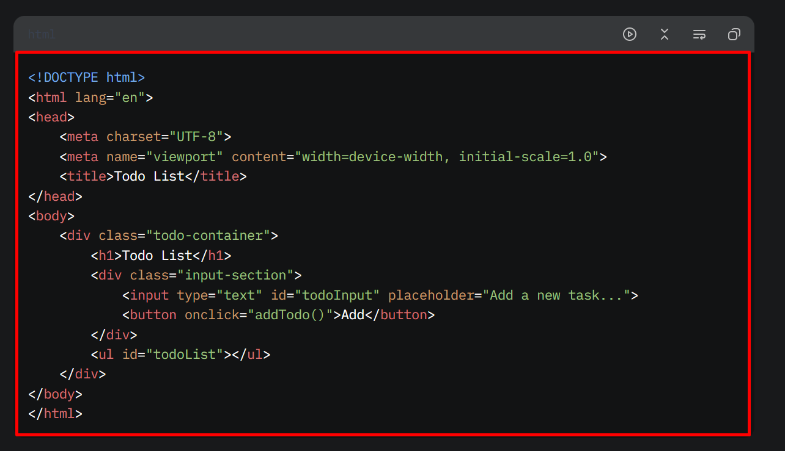
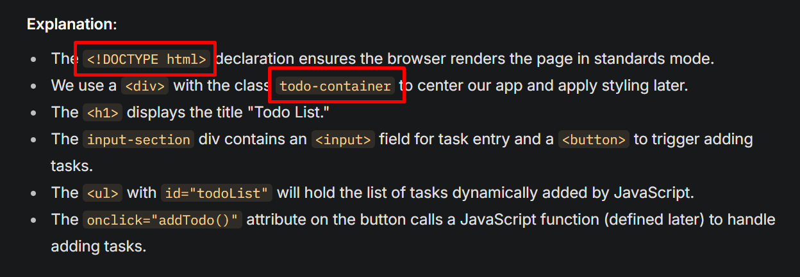

# Day 2: Bài tập về nhà

- [Yêu cầu chung](#yêu-cầu-chung)
- [1. Tạo trang hiển thị một bài thơ](#1-tạo-trang-hiển-thị-một-bài-thơ)
- [2. Tạo một bài viết nói về bài thơ trên](#2-tạo-một-bài-viết-nói-về-bài-thơ-trên)
- [3. Highlight code trong nội dung bài viết](#3-highlight-code-trong-nội-dung-bài-viết)
- [4. Xây dựng trang giới thiệu bản thân](#4-xây-dựng-trang-giới-thiệu-bản-thân)

> **Đọc kỹ từng yêu cầu và thực hiện chính xác. Tuyệt đối không dùng AI với mục đích giải hộ bài tập.**

## Yêu cầu chung

- Tạo dự án mới trên CodeSandbox hoặc Github (nếu bạn đã biết, nhớ là deploy trên Github Pages nữa nhé).
- Toàn bộ các thẻ `<title>` trong các bài tập dưới đều có nội dung trùng với `h1` trong bài.

> **Chú ý để ở chế độ unlisted hoặc public để mọi người có thể truy cập được.**

## 1. Tạo trang hiển thị một bài thơ

1. Tạo file `index.html` và tìm một bài thơ có ít nhất 3 khổ thơ và trình bày với HTML. Sử dụng thẻ tiêu đề phù hợp cho tên bài thơ.

2. Phía dưới bài thơ, thêm phần thông tin liên hệ gồm:
    - Tác giả: [Tên tác giả]
    - Email liên hệ: [email@cua.ban]
    - Số điện thoại: [sdt-cua-ban]

3. Trình bày mỗi thông tin trên nằm trên một hàng mới nhưng chỉ sử dụng 1 thẻ `p`.

4. Có thể nhấn vào địa chỉ email và số điện thoại để mở ứng dụng gửi email hoặc gọi điện.

## 2. Tạo một bài viết nói về bài thơ trên

1. Tạo file `news.html`

2. Dán nội dung bài thơ ở bài 1 vào ChatGPT (hoặc tương tự) và yêu cầu:
    - “Viết bài giới thiệu về bài thơ trên với outline gồm có 1 thẻ `h1`, ít nhất 10 thẻ `h2`, một số thẻ `h2` có từ 2-3 thẻ `h3`. Sau mỗi `h2`, `h3` hãy viết từ 2-5 đoạn văn phù hợp, mỗi đoạn từ 30-50 từ. Không sử dụng `id` và thẻ `a`, chỉ bao gồm các thẻ `h1`, `h2`, `h3` và `p`. Viết bằng HTML trong canvas”.

3. Nhận bài viết, bố cục phù hợp vào `body` của `news.html`.
    - Thẻ `h1` chứa tên bài thơ - Tác giả
    - Sau thẻ `h1`, dùng thẻ `ul`, `li` và `a` tạo mục lục chính xác cho các `h2`, `h3` của bài viết
    - Trình bày các phần còn lại của bài viết phía sau mục lục. Đảm bảo nội dung đủ dài để xuất hiện thanh cuộn trên trình duyêt. Nếu chưa đủ, yêu cầu AI “Viết thêm 5 mục h2 với đầy đủ các yêu cầu như trên”. Lấy nội dung mới, đặt vào sau cùng nội dung hiện tại.

4. Thêm `id` cho toàn bộ các `h2` và `h3` không trùng nhau (nên dùng chữ thường không dấu cách nhau bằng gạch ngang). Thẻ `a` trong phần mục lục, code thêm để khi click vào mục lục sẽ nhảy tới chính xác heading tương ứng.

5. Bên trong mỗi `h2` và `h3`, bổ sung thẻ `a` ôm nội dung chữ hiện tại, nhấn vào thẻ `a` này cũng sẽ nhắm tới chính thẻ heading cha của nó.

## 3. Highlight code trong nội dung bài viết

1. Bảo AI: “Hãy viết blog hướng dẫn xây dựng ứng dụng Todo list gồm chức năng thêm, hiển thị danh sách và xóa. Sử dụng HTML, CSS và JavaScript. Hãy hướng dẫn từng bước, có mô tả trước khối code, có giải thích sau khối code”.

2. Hãy phân tích và code lại câu trả lời của AI bằng HTML (coi câu trả lời của AI là một trang web) và đặt tên file là `blog.html`.

3. Sử dụng PrismJS để highlight các khối code (highlight đúng ngôn ngữ) trong bài viết. Highlight theme bạn tùy ý chọn, chỉ chọn 1 theme cho đồng nhất.

**Lưu ý:**

Những khối code như này dùng thẻ `pre` để giữ định dạng, thẻ `code` để bọc nội dung code. Bởi thẻ `pre` là block, thẻ `code` là inline nên `pre` bọc `code`.

Còn những điểm như này chỉ sử dụng thẻ `code`, bởi nó là nội dung code inline:

*Nếu cố ý sử dụng thẻ `pre` thì thứ nhất là sai mục đích, bởi nội dung code inline không cần giữ nguyên định dạng của các khoảng trắng; thứ hai là thẻ `pre` là block nên sẽ phá vỡ cấu trúc inline (thẻ block sẽ nằm trên một dòng mới).*

## 4. Xây dựng trang giới thiệu bản thân

1. Tất cả yêu cầu phía dưới thực hiện trong file `intro.html`

2. Sử dụng các thẻ HTML đã học để bố cục một trang giới thiệu bản thân của bạn, đảm bảo sử dụng chính xác Semantic của các thẻ HTML.

3. Áp dụng đủ 3 cách viết CSS:
    - Internal CSS
    - Inline CSS
    - External CSS

4. Bổ sung một đoạn văn giới thiệu ngắn về bản thân (phía sau tên), trong đoạn văn này hãy tự tạo tình huống để sử dụng non-breaking space một cách hợp lý. Ví dụ: …“cao 170 cm”… (xem lại bài học record nếu không hiểu ý).

> **Bạn có thể áp dụng CSS tùy ý (các thuộc tính CSS đã học, hoặc nhiều hơn nếu bạn đã biết), tránh ghi đè thuộc tính giữa các cách khác nhau. Mục tiêu bài đảm bảo các bạn phân biệt và thành thạo cách sử dụng 3 cách.**

💪 **Tự code, tự làm, không bảo “AI” làm hộ – Chúc bạn hoàn thành tốt bài tập!** 🚀